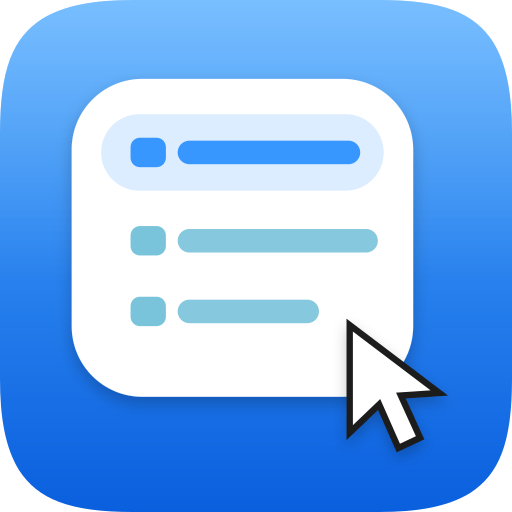

# Right+ (RightPlus App)

<p align="center">
  
</p>

<p align="center">
  <b>极轻、原生、高效的 macOS 访达 (Finder) 右键增强扩展工具</b>
</p>

<p align="center">
  <a href="https://github.com/jixiaoyong/RightPlus-App/releases/latest"></a>
  
  
  
</p>

---

## 🌟 简介

**Right+** 是一款专为 macOS 设计的极简原生 Finder 右键菜单扩展利器。它基于 Apple 原生 `FIFinderSync` 框架用 Swift 编写，无冗余常驻服务，内存占用低至微乎其微。

### 核心亮点

- 📄 **常用文件快速新建**：支持快速新建 Markdown (`.md`)、Word (`.docx`)、Excel (`.xlsx`)、PPT (`.pptx`)、纯文本 (`.txt`)、Shell (`.sh`)、Python (`.py`) 等文件；支持自定义模版，同名自动递增命名，安全不覆盖。
- 🚀 **常用应用快速唤起**：将日常必备的高频编辑器（VS Code、Sublime Text、Typora、Xcode 等）固定在右键，支持智能文件关联匹配。
- 📋 **多选批量复制路径 / 文件名**：一键提取所选文件的绝对 POSIX 路径或文件名，支持多选按换行批量整理，无缝粘贴至终端与脚本中。
- 💻 **所在目录直达终端**：右键快速在系统终端或 iTerm2 中直接定位当前文件所在目录。
- ⚡ **原生 Universal 二进制**：针对 Apple Silicon (M 系列芯片) 与 Intel 架构深度优化，菜单响应经过异步预热缓存优化，首次点击告别卡顿。
- 🔒 **100% 离线 & 隐私安全**：绝无网络通信、绝不上报数据，所有配置与缓存严格保留在本机。

---

## 📥 下载与安装

### 1. 下载

请前往 [GitHub Releases](https://github.com/jixiaoyong/RightPlus-App/releases/latest) 下载最新版本的 `RightPlus-v*.zip` 压缩包。

### 2. 安装步骤

1. 双击解压下载的 zip 压缩包，获得 `RightPlus.app`。
2. 将 `RightPlus.app` 拖入系统 **访达 -> 应用程序 (Applications)** 目录。
3. **解除 Gatekeeper 安全隔离（仅首次需要）**：
   本项目短期内未加入 Apple Developer 开发者计划（未签名公证），若首次启动提示“无法验证开发者”或“损坏”，打开 **终端 (Terminal)** 运行一次以下命令即可：
   ```bash
   xattr -cr /Applications/RightPlus.app
   ```
4. **启用访达扩展**：
   * 启动 `RightPlus.app`；
   * 打开 macOS **系统设置 -> 隐私与安全性 -> 扩展 -> 访达扩展**；
   * 勾选启用 **Right+**；
   * 若扩展未立即出现，可在终端执行 `killall Finder` 刷新访达缓存。

---

## 🌐 静态网页落地页 (GitHub Pages)

本项目自带精美的现代化静态展示页，可以直接托管于 GitHub Pages：
- 在线预览：[https://jixiaoyong.github.io/RightPlus-App/](https://jixiaoyong.github.io/RightPlus-App/)

---

## 🛠 反馈与建议

如果您在使用过程中遇到任何问题或有新功能构想，欢迎随时提交 [Issues](https://github.com/jixiaoyong/RightPlus-App/issues)。
